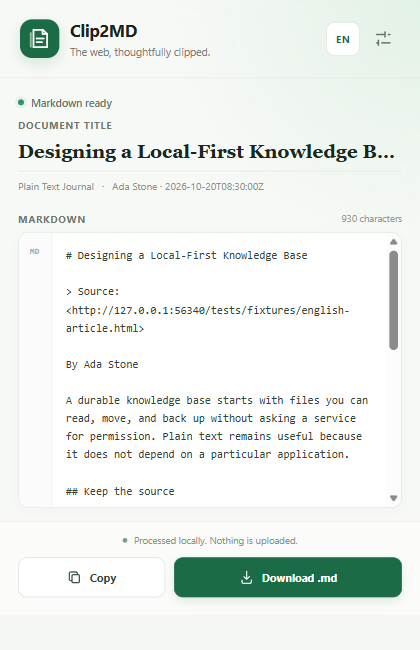
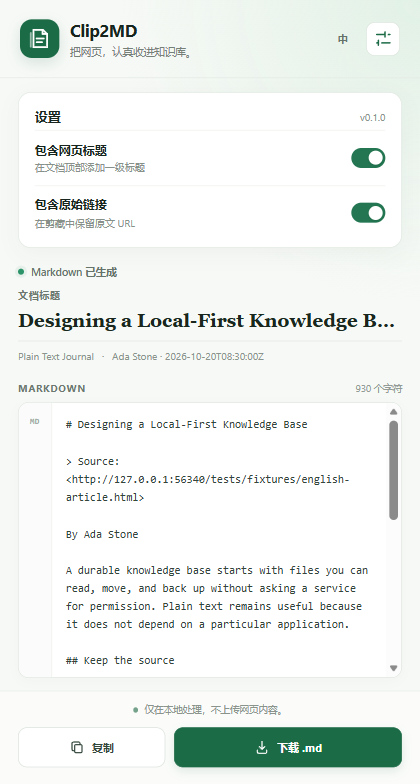
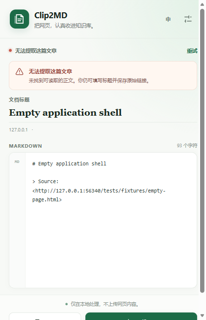

# Clip2MD

**Turn web articles into clean, editable Markdown — locally.**

[简体中文](README.zh-CN.md) · [Releases](https://github.com/manwhatcanisay24/clip2md/releases) · [Privacy](PRIVACY.md) · [Contributing](CONTRIBUTING.md)

[](https://github.com/manwhatcanisay24/clip2md/actions/workflows/ci.yml)
[](https://github.com/manwhatcanisay24/clip2md/releases/tag/v0.1.0)
[](LICENSE)
[](https://developer.chrome.com/docs/extensions/develop/migrate/what-is-mv3)

Clip2MD is a privacy-first Chrome and Edge extension for people who keep notes in Obsidian, Logseq, Typora, or any Markdown workflow. Click the extension, review the Markdown, then copy it or save a UTF-8 `.md` file. No account, cloud database, or external processing service is required.



## Features in v0.1.0

- **On-demand article extraction** powered by Mozilla Readability.
- **Useful metadata**: title, source URL, site, author, publication date, and clip time when available.
- **Clean Markdown** for headings, paragraphs, emphasis, links, images, lists, quotes, inline code, and fenced code blocks with language detection.
- **Preview and edit** the source before copying or downloading.
- **Safe downloads** with UTF-8 encoding and sanitized filenames, including Chinese titles.
- **Simple options** to include or omit the page title and original link.
- **English and 简体中文 UI**, following the browser by default and switchable in the popup.
- **Graceful fallback** for unsupported or unreadable pages: edit the title and retain the source link.
- **Local-first**: page content is not uploaded by this extension.

## Install

### From a GitHub Release

1. Open the [v0.1.0 Release](https://github.com/manwhatcanisay24/clip2md/releases/tag/v0.1.0) and download `clip2md-0.1.0-chrome.zip`.
2. Extract the ZIP into a permanent folder. Do not delete or move it after installation.
3. Open `chrome://extensions` in Chrome or `edge://extensions` in Edge.
4. Enable **Developer mode**.
5. Choose **Load unpacked** and select the extracted folder.
6. Pin **Clip2MD** to the toolbar for quick access.

This release is distributed as an unpacked Manifest V3 extension, not yet as a Chrome Web Store or Edge Add-ons listing.

## Use

1. Open an article on an `http` or `https` page.
2. Click the **Clip2MD** toolbar icon and wait for extraction.
3. Edit the document title or Markdown if needed.
4. Click **Copy** or **Download .md**.

Open **Settings** in the popup to control the H1 title and source link. Click **EN / 中** to switch the interface language. Settings persist locally.

| Chinese popup                                      | Settings                                                 | Extraction fallback                                                             |
| -------------------------------------------------- | -------------------------------------------------------- | ------------------------------------------------------------------------------- |
|  |  |  |

## Permissions and privacy

| Permission / access    | Why it is used                                                                                                    |
| ---------------------- | ----------------------------------------------------------------------------------------------------------------- |
| `activeTab`            | Identifies and communicates with the page you actively clip.                                                      |
| `storage`              | Stores only language and title/source display preferences on your device.                                         |
| HTTP/HTTPS page access | Registers the extraction listener. Page content is read only after you open the extension and request extraction. |

Clip2MD has no analytics, advertising, remote API, account system, or cloud history. Generated Markdown stays in the popup until you copy or download it. Read the full [Privacy Policy](PRIVACY.md).

## Supported content and limitations

v0.1.0 focuses on the core article workflow. It does **not yet** include selection-only clipping, YAML Front Matter, filename templates, local history, image downloading, tables optimization, or saving clips to a GitHub repository. These are tracked in the [version plan](Clip2MD-版本规划.md), not advertised as finished features.

- Browser internal pages, the Web Store, and non-HTTP(S) URLs cannot be clipped.
- Heavily dynamic or unusual layouts may produce incomplete extraction; always review the preview.
- Images remain remote absolute URLs. Offline image archiving is not included.
- Complex tables and site-specific code viewers may need later conversion rules.
- Clip2MD does not bypass login walls, paywalls, CAPTCHAs, or access controls.

## Develop

Requirements: Node.js 20.19+ and npm.

```bash
git clone https://github.com/manwhatcanisay24/clip2md.git
cd clip2md
npm ci
npm run dev
```

WXT opens a development browser. To load manually, run `npm run build` and select `.output/chrome-mv3` under **Load unpacked**.

```bash
npm run typecheck    # Strict TypeScript
npm run lint         # ESLint
npm run format:check # Prettier
npm run test         # Vitest fixture and conversion tests
npm run build        # Production extension
npm run zip          # Release archive
npm run check        # All standard checks above except zip
npm run test:browser # Real Edge end-to-end checks and screenshots
```

The browser test requires Microsoft Edge on Windows. It serves local fixtures, loads the production extension, and verifies extraction, bilingual UI, settings, clipboard, downloads, and fallback behavior. It writes screenshots to `docs/screenshots` and test downloads to `test-results/browser`.

See [CONTRIBUTING.md](CONTRIBUTING.md) for the project layout and contribution workflow.

## Roadmap

- **v0.2.0** — selection clipping, Front Matter, filename templates.
- **v0.3.0** — local history and reusable templates.
- **v0.4.0** — improved code, tables, images, and site adapters.
- **v0.5.0** — optional GitHub repository saving.
- **v0.9.0 / v1.0.0** — compatibility, privacy, release candidate, and stable release hardening.

The detailed scope and acceptance criteria live in [Clip2MD-版本规划.md](Clip2MD-版本规划.md). Changes for this release are in [CHANGELOG.md](CHANGELOG.md).

## License

[MIT](LICENSE) © 2026 Clip2MD contributors
